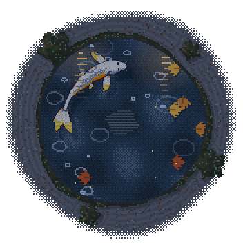
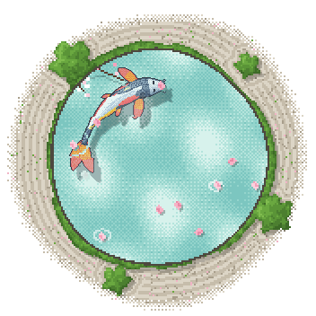
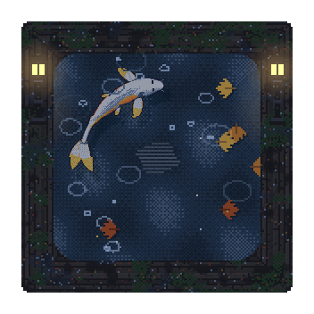
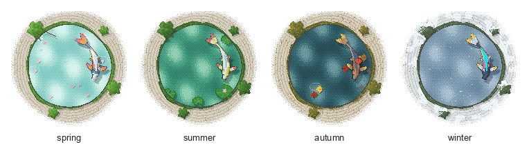
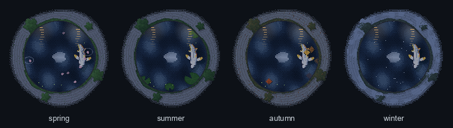
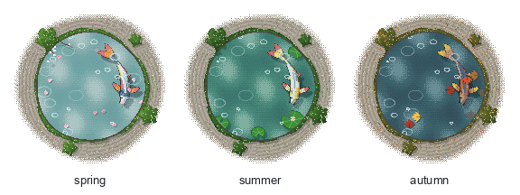
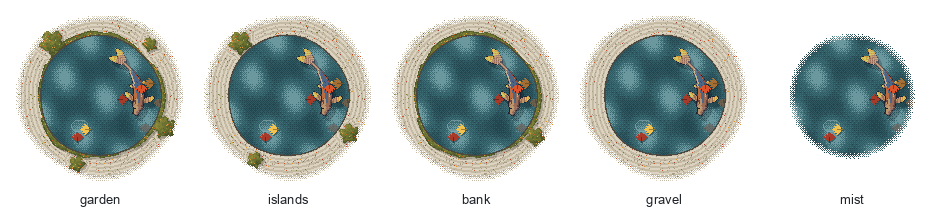
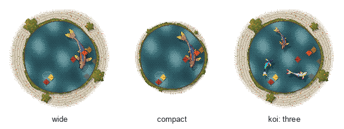

# Git koi, with a pond

> This is a fork of [yalongwastaken/git-koi](https://github.com/yalongwastaken/git-koi)
> by Anthony Yalong, which draws a pixel-art koi from a GitHub account's
> activity. **This fork gives the koi a pond to swim in**: a garden that
> changes with the seasons, rain and snow, a night pond for viewers in dark
> mode, and a set of styles to choose from. The koi itself is drawn exactly as
> the original draws it; nothing in the Rust code is changed.

<table>
<tr>
<td align="center"><br><sub>Autumn, raining</sub></td>
<td align="center"><br><sub>The same day, in dark mode</sub></td>
</tr>
<tr>
<td align="center"><br><sub>Spring, clear</sub></td>
<td align="center"><br><sub>Old oak deck, rainy night</sub></td>
</tr>
</table>

## Using the pond

Add the pond options to the git-koi step in your profile repository's
workflow (the original setup is in [docs/getting-started.md](docs/getting-started.md)):

```yaml
- uses: yafet-a/git-koi@main   # pin a commit SHA for anything you rely on
  with:
    body: auto       # the koi colour that suits each season
    scene: auto      # follow the calendar
    night: "true"    # also draw koi-night.gif for dark mode
```

and show the right GIF for each viewer's theme in your README:

```html
<picture>
  <source media="(prefers-color-scheme: dark)" srcset="koi/koi-night.gif" />
  
</picture>
```

Commit `koi/koi-night.gif` alongside `koi/koi.gif` in the workflow's commit step.

### How each pond is decided

- **The koi** is git-koi's, redrawn every night from your public activity:
  languages colour it, contributions grow it, streaks mark it, and the day
  that just ended decides how it swims.
- **The season** comes from the date the job runs (UTC): March to May
  spring, June to August summer, September to November autumn, December to
  February winter. Each season dresses the pond: blossom, lily pads, falling
  leaves, or ice and snow.
- **The weather** is laid over the season. With `weather: auto` it rains on
  about one day in seven, in any season but winter, which snows instead. Which
  days is decided by a hash of the date, so it falls in no pattern and a rerun
  on the same day draws the same pond.
- **Night** is not the time of day: a README cannot know the viewer's clock.
  With `night: "true"` the job also draws the same pond, in the same season and
  weather, at night, and the `<picture>` tag shows it to anyone in dark mode.
- **The body colour** with `body: auto` follows the season: asagi in spring,
  gold in summer, tea in autumn, black in winter, platinum at night.
- **Falling leaves and petals** land somewhere different each day
  (`drops: random`); a GIF loops, so within one day they repeat.

### Every option

| Input | Values | Default |
| --- | --- | --- |
| `scene` | `none` (the plain koi), `auto`, `spring`, `summer`, `autumn`, `winter` | `none` |
| `weather` | `auto`, `clear`, `rain` | `auto` |
| `night` | `"true"`, `"false"` | `"false"` |
| `body` | `auto`, `white`, `black`, `asagi`, `tea`, `gold`, `platinum` | `white` |
| `garden` | `garden`, `islands`, `bank`, `gravel`, `deck`, `deckdark`, `deckold`, `deckgrey`, `deckwalnut`, `mist` | `garden` |
| `size` | `wide` (352 px, koi full size), `compact` (256 px, koi at 90%) | `wide` |
| `lights` | `reflect`, `onefloat`, `floating`, `euro`, `toro`, `chinese`, `string`, `none` | `reflect` |
| `moon` | `lines`, `round`, `halo`, `crescent`, `glade`, `none` | `lines` |
| `depth` | `under` (beneath lily pads, leaves and reflections), `top` | `under` |
| `drops` | `random`, `fixed` | `random` |
| `koi` | `one`, `three` | `one` |

Everything outside the pond is transparent, so it sits on GitHub's page in
light or dark mode rather than as a square.

### The options side by side

To try every combination live, download
[docs/explorer.html](docs/explorer.html) and open it in a browser. It runs the
same drawing code as the Action.

**Seasons** (`scene`)




**Rain** (`weather: rain`), by day and at night




**Gardens** (`garden`): moss bank and islands, islands only, bank only, raked gravel, and no edge



**Decks** (`garden`), here in the rain: oak, dark oak, old mossy oak, weathered grey, walnut with corner posts


**Night lights** (`lights`): reflections only, one floating lantern, several, old European lamps, stone lanterns, paper lanterns, string lights


**Moons** (`moon`)


**Koi colours** (`body`)


**Sizes** (`size`, `koi`)



**Under the water** (`depth`): on top, as plain git-koi, and beneath the surface


### What this fork changes

- **`action.yml`** gains the inputs above. They all default to off or to the
  original behaviour, so the Action does exactly what git-koi does unless you
  set `scene`.
- **`scenes/pond.html`** draws the pond. It is the same page as
  `docs/explorer.html`, so what you see there is what the Action draws.
- **`scenes/pond.py`** picks the season and weather, draws each koi it needs
  with git-koi's own released program (checksum-verified, as upstream does),
  has headless Chrome render the page's 120 frames, and writes the GIF.
- **Requirements:** Python 3 and Chrome or Chromium on the runner. GitHub's
  hosted runners have both; the Action installs Pillow for itself.

---

The original README follows.

# Git koi

Git koi draws a pixel-art koi from a GitHub account's public activity. Its
languages color it, its contributions grow it, its streaks mark it, and the day
that just ended decides how it swims. A nightly workflow puts the koi on a
profile README as a looping GIF, the same tool runs from the command line, and
the Rust library underneath is published on crates.io.

<p align="center">
  
</p>

<picture>
  <source media="(prefers-color-scheme: dark)" srcset="docs/bodies-dark.png" />
  
</picture>

## Repository Structure

```text
.
├── .github/      workflows, issue forms, and Dependabot
├── docs/         the getting-started guide and the render sheets
├── examples/     the profile workflow and the koi library generator
├── src/          the library and the git-koi command
├── tests/        the public-boundary tests and their fixtures
└── action.yml    the GitHub Action
```

## Usage

### Requirements

- For a koi on your profile README: a GitHub account. The Action runs in your
  profile repository's workflow with its built-in token.
- For the command line: a binary from the
  [releases page](https://github.com/yalongwastaken/git-koi/releases), or Rust
  at or above the `rust-version` in [Cargo.toml](Cargo.toml), plus the
  [GitHub CLI](https://cli.github.com), authenticated.
- For the library: Rust at or above that same version.

[docs/getting-started.md](docs/getting-started.md) walks through all three: the
Action in a profile workflow, the command line, and the library. The API is
documented on [docs.rs](https://docs.rs/git-koi).

## Author

**Anthony Yalong**

- Email: yalong.anthony123@gmail.com
- GitHub: [@yalongwastaken](https://github.com/yalongwastaken)

## License

MIT. See [LICENSE](LICENSE).
