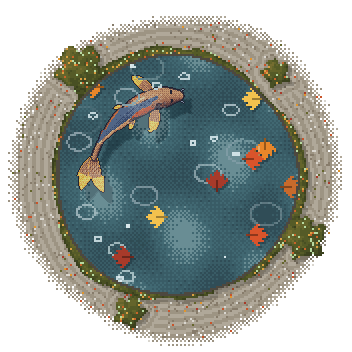
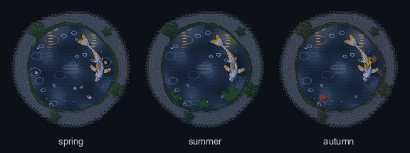
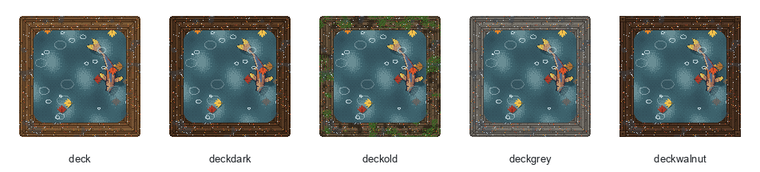
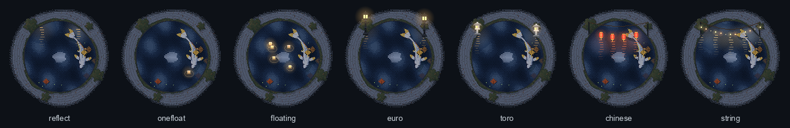
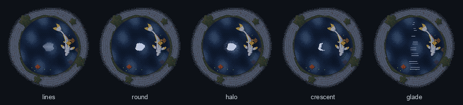
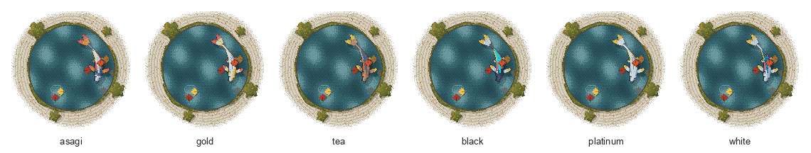
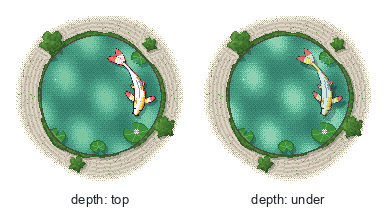
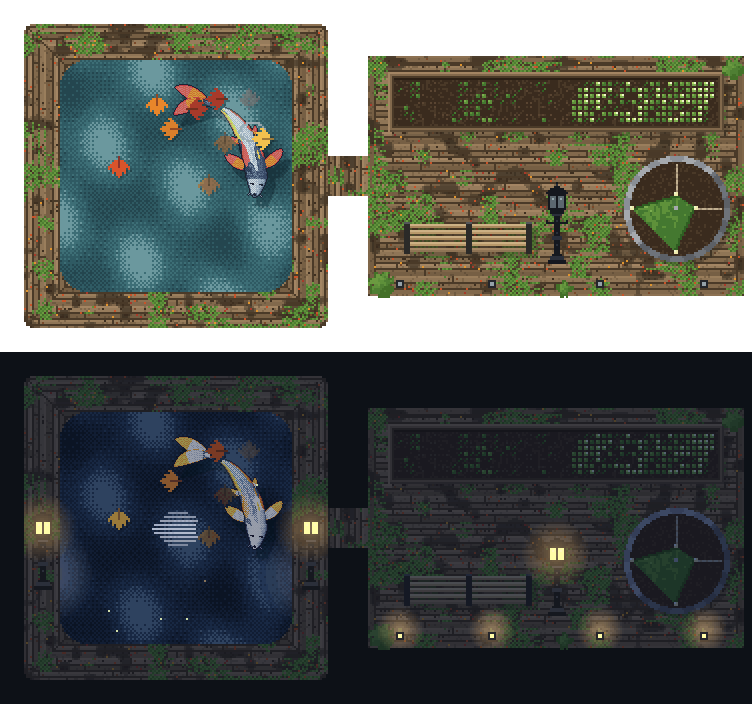

# Git koi, with a pond

> This is a fork of
> [yalongwastaken/git-koi](https://github.com/yalongwastaken/git-koi) by Anthony
> Yalong, which draws a pixel-art koi from a GitHub account's activity. **This
> fork gives the koi a pond to swim in**: a garden that changes with the
> seasons, rain and snow, a night pond for viewers in dark mode, and a set of
> styles to choose from. The koi itself is drawn exactly as the original draws
> it; nothing in the Rust code is changed.

<table>
<tr>
<td align="center"><br><sub>Autumn, raining</sub></td>
<td align="center"><br><sub>The same day, in dark mode</sub></td>
</tr>
<tr>
<td align="center"><br><sub>Spring, clear</sub></td>
<td align="center"><br><sub>Old oak deck, rainy night</sub></td>
</tr>
</table>

## Using the pond

Add the pond options to the git-koi step in your profile repository's workflow
(the original setup is in [docs/getting-started.md](docs/getting-started.md)):

```yaml
- uses: yafet-a/git-koi@main # pin a commit SHA for anything you rely on
  with:
    body: auto # the koi colour that suits each season
    scene: auto # follow the calendar
    night: "true" # also draw koi-night.gif for dark mode
```

and show the right GIF for each viewer's theme in your README:

```html
<picture>
  <source media="(prefers-color-scheme: dark)" srcset="koi/koi-night.gif" />
  
</picture>
```

Commit `koi/koi-night.gif` alongside `koi/koi.gif` in the workflow's commit
step.

### How each pond is decided

- **The koi** is git-koi's, redrawn every night from your public activity:
  languages colour it, contributions grow it, streaks mark it, and the day that
  just ended decides how it swims.
- **The season** comes from the date the job runs (UTC): March to May spring,
  June to August summer, September to November autumn, December to February
  winter. Each season dresses the pond: blossom, lily pads, falling leaves, or
  ice and snow.
- **The weather** is laid over the season. With `weather: auto` it rains on
  about one day in seven, in any season but winter, which snows instead. Which
  days is decided by a hash of the date, so it falls in no pattern and a rerun
  on the same day draws the same pond.
- **Night** is not the time of day: a README cannot know the viewer's clock.
  With `night: "true"` the job also draws the same pond, in the same season and
  weather, at night, and the `<picture>` tag shows it to anyone in dark mode.
- **The body colour** with `body: auto` follows the season: asagi in spring,
  gold in summer, tea in autumn, black in winter, platinum at night.
- **Falling leaves and petals** land somewhere different each day
  (`drops: random`); a GIF loops, so within one day they repeat.

### Every option

| Input     | Values                                                                                                 | Default   |
| --------- | ------------------------------------------------------------------------------------------------------ | --------- |
| `scene`   | `none` (the plain koi), `auto`, `spring`, `summer`, `autumn`, `winter`                                 | `none`    |
| `weather` | `auto`, `clear`, `rain`                                                                                | `auto`    |
| `night`   | `"true"`, `"false"`                                                                                    | `"false"` |
| `body`    | `auto`, `white`, `black`, `asagi`, `tea`, `gold`, `platinum`                                           | `white`   |
| `garden`  | `garden`, `islands`, `bank`, `gravel`, `deck`, `deckdark`, `deckold`, `deckgrey`, `deckwalnut`, `mist` | `garden`  |
| `size`    | `wide` (352 px, koi full size), `compact` (256 px, koi at 90%)                                         | `wide`    |
| `lights`  | `reflect`, `onefloat`, `floating`, `euro`, `toro`, `chinese`, `string`, `none`                         | `reflect` |
| `moon`    | `lines`, `round`, `halo`, `crescent`, `glade`, `none`                                                  | `lines`   |
| `depth`   | `under` (beneath lily pads, leaves and reflections), `top`                                             | `under`   |
| `drops`   | `random`, `fixed`                                                                                      | `random`  |
| `koi`     | `one`, `three`                                                                                         | `one`     |
| `layout`  | `pond`, `garden` (the pond beside a deck; needs `size: wide`)                                          | `pond`    |
| `scale`   | `"1"`, `"2"` (each pixel 2 by 2, sharp on high-density screens)                                        | `"1"`     |

Everything outside the pond is transparent, so it sits on GitHub's page in light
or dark mode rather than as a square.

### The options side by side

To try every combination live, download [docs/explorer.html](docs/explorer.html)
and open it in a browser. It runs the same drawing code as the Action.

**Seasons** (`scene`)


**Rain** (`weather: rain`), by day and at night




**Gardens** (`garden`): moss bank and islands, islands only, bank only, raked
gravel, and no edge


**Decks** (`garden`), here in the rain: oak, dark oak, old mossy oak, weathered
grey, walnut with corner posts



**Night lights** (`lights`): reflections only, one floating lantern, several,
old European lamps, stone lanterns, paper lanterns, string lights



**Moons** (`moon`)



**Koi colours** (`body`)



**Sizes** (`size`, `koi`)


**Under the water** (`depth`): on top, as plain git-koi, and beneath the surface



**The garden** (`layout: garden`), by day and at night: the pond on the left, a
boardwalk out to a deck with the last year's contributions growing in a planter
(one tuft of moss per day, fuller on busier days, as GitHub's graph shades
them), the activity overview as a round bed (moss grows along each path as far
as that share of commits, pull requests, issues and reviews reaches), and a
bench under a gas lamp, with low lights along the edge. The deck follows the
seasons like the pond's own. The garden also writes `koi-pond.gif` (and
`koi-pond-night.gif`), the pond alone, so a README can show the pond on narrow
screens:

```html
<picture>
  <source
    media="(max-width: 700px) and (prefers-color-scheme: dark)"
    srcset="koi/koi-pond-night.gif"
  />
  <source media="(max-width: 700px)" srcset="koi/koi-pond.gif" />
  <source media="(prefers-color-scheme: dark)" srcset="koi/koi-night.gif" />
  
</picture>
```

With `scale: "2"`, keep the `width` at the picture's usual size (752 for the
garden, 352 for the pond) and the extra pixels make it sharp on high-density
screens. The explorer page does not show the garden yet.



### What this fork changes

- **`src/pond.rs`** (new) draws the pond around the koi frames git-koi already
  renders, in the same process: the water, the season's dressing, rain and snow,
  the garden or deck, the lamps and moon at night, and the koi under the
  surface. Like the rest of the crate it is deterministic: the date is the
  snapshot's observation date, and nothing reads the clock.
- **`git-koi pond`** (new subcommand) writes `koi.gif`, and with `--night` also
  `koi-night.gif`. Run `git-koi pond --help` for every flag.
- **`src/garden.rs`** (new) lays the pond's frames into the wider garden for
  `--layout garden`.
- **`output::encode_pond_gif`** (new) encodes the pond with one shared
  255-colour palette (the koi's own GIF uses exact colours, but a pond has
  gradients and glow), and after the first frame stores only the pixels that
  changed, which keeps a sharp `scale: "2"` garden under 2 MB.
- **`action.yml`** gains the inputs above and calls `git-koi pond`. With
  `scene: none`, the default, it does exactly what the original does.
- **Releases** come from this fork, so the Action downloads this fork's
  binaries; the release workflow no longer publishes the crate, whose name
  belongs to the original project.
- **`scenes/pond.html`** is the explorer, a JavaScript twin of `src/pond.rs`
  drawn by the same rules; `scenes/build_explorer.py` embeds koi frames into it
  as `docs/explorer.html`.

The Rust code in the original crate is untouched apart from registering the new
module and the new subcommand.

---

The original README follows.

# Git koi

Git koi draws a pixel-art koi from a GitHub account's public activity. Its
languages color it, its contributions grow it, its streaks mark it, and the day
that just ended decides how it swims. A nightly workflow puts the koi on a
profile README as a looping GIF, the same tool runs from the command line, and
the Rust library underneath is published on crates.io.

<p align="center">
  
</p>

<picture>
  <source media="(prefers-color-scheme: dark)" srcset="docs/bodies-dark.png" />
  
</picture>

## Repository Structure

```text
.
├── .github/      workflows, issue forms, and Dependabot
├── docs/         the getting-started guide and the render sheets
├── examples/     the profile workflow and the koi library generator
├── src/          the library and the git-koi command
├── tests/        the public-boundary tests and their fixtures
└── action.yml    the GitHub Action
```

## Usage

### Requirements

- For a koi on your profile README: a GitHub account. The Action runs in your
  profile repository's workflow with its built-in token.
- For the command line: a binary from the
  [releases page](https://github.com/yalongwastaken/git-koi/releases), or Rust
  at or above the `rust-version` in [Cargo.toml](Cargo.toml), plus the
  [GitHub CLI](https://cli.github.com), authenticated.
- For the library: Rust at or above that same version.

[docs/getting-started.md](docs/getting-started.md) walks through all three: the
Action in a profile workflow, the command line, and the library. The API is
documented on [docs.rs](https://docs.rs/git-koi).

## Author

**Anthony Yalong**

- Email: yalong.anthony123@gmail.com
- GitHub: [@yalongwastaken](https://github.com/yalongwastaken)

## License

MIT. See [LICENSE](LICENSE).
